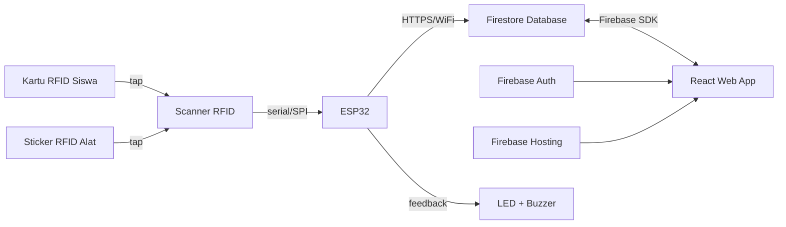

# Plan Implementasi: Sistem Peminjaman Alat Lab Berbasis RFID + Web (PKM)

> **Skema IoT: Opsi 1** — Kartu RFID untuk perwakilan kelas + Sticker RFID untuk tiap alat. Keduanya dibaca lewat scanner RFID (RC522), lalu ESP32 mengirim kombinasi UID kartu + UID alat ke Firestore. Konfigurasi hardware disiapkan untuk 2 kemungkinan: **1 scanner** (gantian tap) atau **2 scanner** (kartu & alat terpisah) — tinggal pilih salah satu saat implementasi, lihat Bagian 1.1 dan 8.

## 1. Ringkasan Arsitektur



**Alur singkat:**
1. Perwakilan kelas tap **kartu RFID** dan sticker **RFID di alat** ke scanner (urutan/jumlah scanner tergantung konfigurasi yang dipilih — lihat 1.1).
2. ESP32 baca kedua UID (kartu + alat), kirim ke Firestore lewat HTTPS request ke Cloud Function.
3. Cloud Function validasi kedua UID, cek status alat saat ini, lalu **otomatis menentukan jenis transaksi** (pinjam/kembali) tanpa petugas perlu pilih manual.
4. Petugas di dashboard React melihat notifikasi real-time berisi kombinasi "kelas X meminjam/mengembalikan alat Y", lalu tinggal klik **Konfirmasi**.
5. Status alat & histori transaksi otomatis ke-update di Firestore, langsung terlihat di dashboard.

### 1.1 Dua Konfigurasi Hardware yang Disiapkan

| Konfigurasi | Cara Kerja | Kapan Cocok Dipakai |
|---|---|---|
| **A — 1 Scanner** | 1 modul RC522. Kartu ditap dulu → sistem "ingat" UID kartu selama beberapa detik (window waktu, misal 10 detik) → lalu sticker alat ditap ke scanner yang sama → ESP32 gabungkan jadi satu payload. | Kalau mau hemat 1 modul RC522, dan oke dengan sedikit tambahan waktu tap berurutan. |
| **B — 2 Scanner** | 2 modul RC522 terpisah (1 khusus baca kartu, 1 khusus baca sticker alat), keduanya tersambung ke ESP32 yang sama lewat pin CS/SS berbeda. Kartu dan alat bisa ditap kapan saja tanpa saling menunggu. | Kalau mau transaksi lebih cepat & logic firmware lebih simpel (tidak perlu window waktu/state sementara). |

> Firmware & Cloud Function di bawah ini ditulis dengan flag konfigurasi (`SCANNER_MODE = "1_SCANNER"` atau `"2_SCANNER"`) supaya AI agent tinggal pilih salah satu tanpa perlu menulis ulang seluruh logic.

---

## 2. Tech Stack Final

| Layer | Teknologi |
|---|---|
| Hardware | ESP32 + RFID Reader RC522 **x1 (Konfigurasi A) atau x2 (Konfigurasi B)** + Kartu Mifare 1K (4 kartu kelas) + Sticker RFID Mifare 1K (50 pcs, 1 per alat) + LED + Buzzer |
| Firmware | Arduino IDE / PlatformIO (C++) |
| Frontend | React + Vite + tailwind |
| Auth | Firebase Authentication (email/password) |
| Database | Cloud Firestore |
| Hosting | Firebase Hosting |
| Komunikasi IoT → Cloud | HTTPS REST call dari ESP32 ke Cloud Function, atau langsung ke Firestore REST API |

---

## 3. Role & Akses

| Role | Jenis | Akses |
|---|---|---|
| **Admin** | Akun login web | CRUD alat, CRUD kartu RFID, CRUD akun petugas, lihat semua laporan/histori |
| **Petugas Lab** | Akun login web | Lihat notifikasi tap kartu, konfirmasi peminjaman/pengembalian, lihat status alat |
| **Perwakilan Kelas** | Fisik (kartu RFID) | Tidak login web sama sekali, hanya tap kartu |

---

## 4. Firestore Database Schema

### Collection: `users`
Menyimpan akun Admin & Petugas (selain via Firebase Auth, ini dipakai buat role-based access).

```
users (collection)
└── {uid} (document, uid = Firebase Auth UID)
    ├── nama: string
    ├── email: string
    ├── role: string        // "admin" | "petugas"
    ├── createdAt: timestamp
```

### Collection: `kartu_rfid`
Data 4 kartu (2 kelas x 1 kartu, atau bisa disesuaikan jadi 2 kartu/kelas sesuai kebutuhan).

```
kartu_rfid (collection)
└── {uid_kartu} (document ID = UID fisik RFID, misal "A1B2C3D4")
    ├── kelas: string          // "XI RPL 1", "XI RPL 2", dst
    ├── nama_pemegang: string  // nama perwakilan kelas (opsional)
    ├── status: string         // "aktif" | "nonaktif" (buat kartu hilang/rusak)
    ├── createdAt: timestamp
```

### Collection: `alat`
50 alat lab.

```
alat (collection)
└── {id_alat} (document, auto-id atau kode alat manual, misal "ALT-001")
    ├── nama: string
    ├── kode: string           // kode inventaris fisik alat
    ├── uid_rfid: string       // UID sticker RFID yang ditempel di alat ini (unik per alat)
    ├── kategori: string       // misal "elektronik", "mekanik", dll
    ├── status: string         // "tersedia" | "dipinjam" | "maintenance"
    ├── stok_total: number     // kalau ada alat sejenis lebih dari 1 unit
    ├── stok_tersedia: number
    ├── createdAt: timestamp
```

### Collection: `transaksi`
Log utama tiap peminjaman/pengembalian.

```
transaksi (collection)
└── {id_transaksi} (document, auto-id)
    ├── uid_kartu: string        // referensi ke kartu_rfid
    ├── uid_alat: string         // referensi UID sticker RFID di alat (audit trail)
    ├── kelas: string            // denormalized, biar gak perlu join tiap query
    ├── id_alat: string          // referensi ke alat
    ├── nama_alat: string        // denormalized
    ├── jenis: string            // "pinjam" | "kembali" (auto-detected, bisa dikoreksi petugas saat konfirmasi)
    ├── status: string           // "menunggu_konfirmasi" | "dikonfirmasi" | "selesai"
    ├── petugas_konfirmasi: string  // uid petugas yang konfirmasi
    ├── waktu_tap: timestamp
    ├── waktu_konfirmasi: timestamp | null
    ├── waktu_kembali: timestamp | null
    ├── catatan: string          // opsional, misal kondisi alat saat kembali
```

### Collection: `tap_log` (buffer sementara dari ESP32)
Beda dari skema sebelumnya — sekarang ESP32 mengirim **kombinasi UID kartu + UID alat sekaligus** (baik didapat dari 1 scanner gantian maupun 2 scanner terpisah), jadi payload-nya sudah lebih lengkap sebelum masuk ke `transaksi`.

```
tap_log (collection)
└── {id_log} (document, auto-id)
    ├── uid_kartu: string
    ├── uid_alat: string
    ├── kelas: string           // hasil lookup dari uid_kartu
    ├── id_alat: string         // hasil lookup dari uid_alat
    ├── jenis_terdeteksi: string  // "pinjam" | "kembali" — auto-detect berdasarkan status alat saat ini
    ├── waktu_tap: timestamp
    ├── status: string          // "pending" | "processed" | "invalid"
```

---

## 5. Logic Alur Sistem (Business Logic)

### A. Alur Tap Kartu + Alat → Notifikasi Petugas

**Konfigurasi A (1 Scanner):**
1. Kartu ditap dulu ke scanner → ESP32 baca UID, simpan sementara di variabel (`pendingKartuUID`), mulai hitung window waktu (misal 10 detik).
2. Sticker alat ditap ke scanner yang sama dalam window waktu tsb → ESP32 baca UID kedua.
3. ESP32 gabungkan `{uid_kartu: pendingKartuUID, uid_alat: uidKedua}` jadi satu payload, kirim ke Cloud Function.
4. Kalau window waktu habis sebelum tap kedua terjadi → `pendingKartuUID` direset, LED kuning berkedip lalu mati (indikasi "batal, ulangi dari awal").

**Konfigurasi B (2 Scanner):**
1. Kartu ditap ke Scanner A, sticker alat ditap ke Scanner B — bisa hampir bersamaan atau berurutan, tidak ada batasan waktu.
2. ESP32 baca dari kedua modul, begitu keduanya sudah terisi dalam siklus loop yang sama (atau salah satu ditunggu maksimal beberapa detik saja) → langsung digabung jadi satu payload dan dikirim.

**Setelah payload terkirim ke Cloud Function (berlaku untuk kedua konfigurasi):**
1. Cloud Function validasi `uid_kartu` ke `kartu_rfid` (harus `status: aktif`) dan `uid_alat` ke `alat` (harus terdaftar).
2. Cloud Function cek `status` alat saat ini:
   - Kalau `tersedia` → `jenis_terdeteksi = "pinjam"`.
   - Kalau `dipinjam` → `jenis_terdeteksi = "kembali"`.
3. Data disimpan ke `tap_log` dengan `status: "pending"`.
4. Dashboard petugas pasang **real-time listener** (`onSnapshot`) ke collection `tap_log` where `status == "pending"`.
5. Begitu ada dokumen baru, dashboard nampilin notifikasi siap-konfirmasi: *"Kelas XI RPL 1 — PINJAM Multimeter #003 — Konfirmasi?"* (jenis transaksi sudah otomatis terisi, petugas tinggal cek & klik, bisa dikoreksi manual kalau ternyata salah deteksi).
6. Petugas klik **Konfirmasi** → sistem:
   - Bikin dokumen di `transaksi`.
   - Update `stok_tersedia` dan `status` di dokumen `alat` terkait.
   - Update `tap_log` jadi `status: "processed"`.
7. ESP32 dapat response sukses dari Cloud Function → nyalain LED hijau + buzzer "tit" satu kali.
8. Kalau ada error (salah satu/kedua UID tidak dikenal, atau gagal kirim) → LED merah + buzzer beda nada, `tap_log` diberi `status: "invalid"`.

### B. Validasi Kartu/Alat Tidak Dikenal

- Cloud Function (bukan ESP32) yang bertanggung jawab validasi: cek `uid_kartu` ada & aktif di `kartu_rfid`, dan `uid_alat` terdaftar di `alat`.
- Kalau salah satu tidak valid, Cloud Function balas error spesifik (`kartu_tidak_valid` atau `alat_tidak_terdaftar`) supaya ESP32 bisa kasih pola LED/buzzer yang beda untuk tiap kasus, memudahkan petugas tahu apa yang salah tanpa harus lihat layar.

### C. Aturan Bisnis Penting

| Aturan | Penjelasan |
|---|---|
| 1 kartu = 1 kelas | Tidak boleh ada 2 kelas pakai kartu yang sama |
| 1 sticker = 1 alat | Tiap alat harus punya `uid_rfid` unik, tidak boleh duplikat antar alat |
| Kartu nonaktif ditolak | Kalau `status: nonaktif`, sistem tolak & LED merah |
| Alat `dipinjam` tidak bisa "dipinjam" lagi | Kalau alat sudah `dipinjam` dan ditap lagi, otomatis dianggap `jenis_terdeteksi: "kembali"`, bukan ditolak |
| Jenis transaksi bisa dikoreksi manual | Auto-detect bukan final — petugas tetap bisa ubah "pinjam" jadi "kembali" atau sebaliknya saat konfirmasi, untuk menangani kasus tak terduga |
| Konfirmasi wajib manual oleh petugas | ESP32/Cloud Function tidak langsung ubah status alat — mencegah kesalahan tanpa sepengetahuan petugas |
| Duplikasi tap dalam waktu singkat | Debounce minimal 3-5 detik untuk kombinasi UID kartu+alat yang sama, biar gak spam request |
| Tap tidak lengkap (Konfigurasi A) | Kalau window waktu habis sebelum tap kedua terjadi, batalkan otomatis dan minta ulang dari tap kartu |

---

## 6. Firestore Security Rules (Draft)

```javascript
rules_version = '2';
service cloud.firestore {
  match /databases/{database}/documents {

    function isSignedIn() {
      return request.auth != null;
    }
    function isAdmin() {
      return isSignedIn() &&
        get(/databases/$(database)/documents/users/$(request.auth.uid)).data.role == "admin";
    }
    function isPetugasOrAdmin() {
      return isSignedIn() &&
        get(/databases/$(database)/documents/users/$(request.auth.uid)).data.role in ["admin", "petugas"];
    }

    match /users/{userId} {
      allow read: if isSignedIn();
      allow write: if isAdmin();
    }

    match /kartu_rfid/{kartuId} {
      allow read: if isPetugasOrAdmin();
      allow write: if isAdmin();
    }

    match /alat/{alatId} {
      allow read: if isPetugasOrAdmin();
      allow write: if isPetugasOrAdmin(); // update status alat pas transaksi
    }

    match /transaksi/{transaksiId} {
      allow read: if isPetugasOrAdmin();
      allow create, update: if isPetugasOrAdmin();
    }

    // tap_log ditulis oleh ESP32 lewat Cloud Function (pakai admin SDK, bypass rules ini)
    match /tap_log/{logId} {
      allow read: if isPetugasOrAdmin();
      allow write: if false; // hanya lewat Cloud Function server-side
    }
  }
}
```

> Catatan: request dari ESP32 sebaiknya **tidak langsung** ke Firestore client SDK (karena butuh API key yang gampang di-reverse dari firmware), tapi lewat **Cloud Function HTTP endpoint** yang pakai Admin SDK. Cloud Function ini juga tempat paling pas buat validasi UID kartu sebelum masuk ke database.

---

## 7. Struktur Halaman Frontend (React)

```
/login              → halaman login (admin & petugas)
/dashboard           → halaman utama petugas: notifikasi tap real-time + form konfirmasi
/alat                → list alat, status, CRUD (admin only)
/kartu               → list & kelola kartu RFID (admin only)
/transaksi           → histori semua transaksi (filter by kelas/tanggal/status)
/laporan             → rekap statistik (alat paling sering dipinjam, dll) — opsional
/users               → kelola akun petugas (admin only)
```

---

## 8. Alur ESP32 (Pseudocode Firmware)

> Pilih salah satu blok di bawah sesuai konfigurasi hardware final (lihat Bagian 1.1). Struktur payload ke Cloud Function sama persis untuk keduanya — bedanya cuma cara ESP32 mengumpulkan kedua UID sebelum dikirim.

### Konfigurasi A — 1 Scanner (gantian tap)

```cpp
setup():
  connect_wifi()
  init_rfid_reader()  // 1 modul RC522
  pendingKartuUID = null
  pendingStartTime = 0
  WINDOW_TIMEOUT = 30000  // 30 detik

loop():
  // reset kalau window habis dan belum ada tap kedua
  if (pendingKartuUID != null && millis() - pendingStartTime > WINDOW_TIMEOUT):
    pendingKartuUID = null
    ledKuning_blink_then_off()  // indikasi batal, ulangi dari tap kartu

  if (rfid.newCardDetected()):
    uid = rfid.readUID()

    if (pendingKartuUID == null):
      // asumsikan tap pertama adalah kartu kelas
      // (validasi jenis UID bisa dicek balik lewat Cloud Function kalau perlu)
      pendingKartuUID = uid
      pendingStartTime = millis()
      ledKuning_ON()  // indikasi "menunggu tap alat"
      return

    // tap kedua dianggap UID alat
    uid_alat = uid
    uid_kartu = pendingKartuUID
    pendingKartuUID = null  // reset session

    response = httpPOST(CLOUD_FUNCTION_URL, {
      uid_kartu: uid_kartu,
      uid_alat: uid_alat,
      timestamp: now()
    })

    if (response.success):
      ledHijau_ON(); buzzer_beep(1)
    else if (response.error == "kartu_tidak_valid"):
      ledMerah_ON(); buzzer_beep(3)
    else if (response.error == "alat_tidak_terdaftar"):
      ledMerah_ON(); buzzer_beep(4)
    else: // gagal koneksi
      ledMerah_ON(); buzzer_beep(2)
      // opsional: simpan ke buffer lokal (SPIFFS) buat retry nanti
```

### Konfigurasi B — 2 Scanner (kartu & alat terpisah)

```cpp
setup():
  connect_wifi()
  init_rfid_reader_kartu()   // modul RC522 #1, pin CS berbeda dari modul #2
  init_rfid_reader_alat()    // modul RC522 #2
  lastUidKartu = null
  lastUidAlat = null
  lastSendTime = 0

loop():
  if (rfid_kartu.newCardDetected()):
    lastUidKartu = rfid_kartu.readUID()

  if (rfid_alat.newCardDetected()):
    lastUidAlat = rfid_alat.readUID()

  // begitu dua-duanya terisi, kirim (tidak perlu urutan tertentu)
  if (lastUidKartu != null && lastUidAlat != null):
    if (millis() - lastSendTime < 4000):
      return  // debounce, cegah kirim ulang kombinasi yang sama terlalu cepat

    response = httpPOST(CLOUD_FUNCTION_URL, {
      uid_kartu: lastUidKartu,
      uid_alat: lastUidAlat,
      timestamp: now()
    })

    lastSendTime = millis()
    lastUidKartu = null
    lastUidAlat = null

    if (response.success):
      ledHijau_ON(); buzzer_beep(1)
    else if (response.error == "kartu_tidak_valid"):
      ledMerah_ON(); buzzer_beep(3)
    else if (response.error == "alat_tidak_terdaftar"):
      ledMerah_ON(); buzzer_beep(4)
    else: // gagal koneksi
      ledMerah_ON(); buzzer_beep(2)
```

---

## 9. Fase Implementasi (Milestone)

| Fase | Task | Estimasi |
|---|---|---|
| **1. Setup dasar** | Buat project Firebase, setup Firestore, Auth, Hosting | 1-2 hari |
| **2. Hardware** | Wiring ESP32 + RC522 (1 atau 2 modul sesuai konfigurasi final), test baca UID kartu & UID sticker alat via Serial Monitor | 2-4 hari |
| **3. Koneksi IoT → Cloud** | Bikin Cloud Function endpoint, test ESP32 kirim data ke Firestore | 3-4 hari |
| **4. Frontend Auth & Dashboard** | Login, real-time listener notifikasi tap | 3-4 hari |
| **5. Fitur CRUD** | Halaman alat, kartu, users | 3-4 hari |
| **6. Fitur Transaksi** | Form konfirmasi pinjam/kembali, update stok alat | 3-4 hari |
| **7. Testing end-to-end** | Tap kartu asli → cek dashboard → cek Firestore | 2-3 hari |
| **8. Polish & Laporan** | UI rapi, dokumentasi, siapkan buat sidang PKM | 3-5 hari |

---

## 10. Antisipasi Masalah Lapangan (dari plan sebelumnya, dipetakan ke solusi teknis)

| Masalah | Solusi di Level Sistem |
|---|---|
| WiFi putus | ESP32 retry otomatis + simpan log lokal sementara (SPIFFS/EEPROM) sebelum kirim ulang |
| Tap ganda | Debounce di firmware (lihat pseudocode di atas) |
| Kartu hilang | Admin set `status: nonaktif` di collection `kartu_rfid`, daftarkan UID baru |
| Sticker alat rusak/lepas | Admin update `uid_rfid` di dokumen `alat` terkait dengan sticker pengganti |
| Delay respons | Tampilkan loading state jelas di LED (misal LED kuning = "processing") |
| Duplikasi transaksi | Cek dulu apakah ada `tap_log` dengan kombinasi UID sama berstatus `pending` sebelum bikin baru |
| Petugas lupa konfirmasi | Tambah reminder/badge jumlah notifikasi belum diproses di dashboard |
| Tap kedua tidak terjadi (Konfigurasi A) | Window timeout otomatis batalkan sesi, LED kuning berkedip lalu mati sebagai sinyal "ulangi dari tap kartu" |
| Salah tap urutan (kartu vs alat tertukar) di Konfigurasi B | Karena scanner terpisah per jenis, secara fisik tidak mungkin tertukar — tapi tetap validasi silang di Cloud Function sebagai *safety net* |

---

## 11. Yang Perlu Disiapkan Sebelum Kasih ke AI Agent

1. Buat Firebase project dulu manual (Console Firebase) → catat `apiKey`, `projectId`, dll dari Firebase config.
2. Tentukan nama-nama kelas & alokasikan UID kartu (bisa didapat setelah scan kartu fisik pertama kali).
3. **Putuskan Konfigurasi A (1 scanner) atau B (2 scanner)** — lihat perbandingan di Bagian 1.1, lalu beri tahu AI agent konfigurasi mana yang dipakai supaya dia ambil blok pseudocode yang sesuai di Bagian 8.
4. Siapkan daftar 50 alat (nama, kode, kategori) dalam bentuk spreadsheet, biar gampang di-import/seed ke Firestore — sekalian tempelkan sticker RFID ke tiap alat lalu catat UID-nya masing-masing ke kolom `uid_rfid`.
5. Tentukan siapa admin & siapa petugas (untuk akun awal).

Dokumen ini bisa langsung lu kasih ke AI agent sebagai spesifikasi awal — dia tinggal generate struktur project React + Cloud Function + firmware ESP32 berdasarkan schema dan logic di atas.