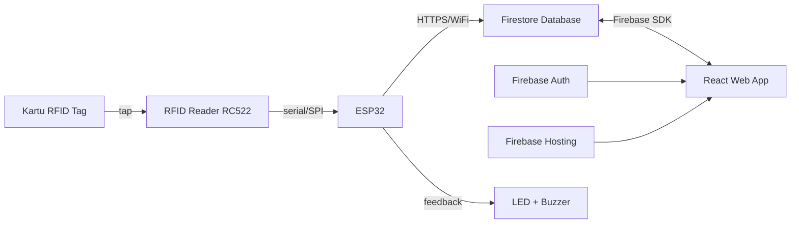

# Plan Implementasi: Sistem Peminjaman Alat Lab Berbasis RFID + Web (PKM)

## 1. Ringkasan Arsitektur



**Alur singkat:**
1. Perwakilan kelas tap kartu ke RFID reader.
2. ESP32 baca UID kartu, kirim ke Firestore lewat HTTPS request.
3. Firestore trigger validasi (via Cloud Function ATAU langsung dari ESP32 request ke endpoint sederhana).
4. Petugas di dashboard React melihat notifikasi real-time, lalu konfirmasi jenis transaksi (pinjam alat apa / kembalikan alat apa).
5. Status alat & histori transaksi otomatis ke-update di Firestore, langsung terlihat di dashboard.

---

## 2. Tech Stack Final

| Layer | Teknologi |
|---|---|
| Hardware | ESP32 + RFID Reader RC522 + Kartu Mifare 1K (4 kartu) + LED + Buzzer |
| Firmware | Arduino IDE / PlatformIO (C++) |
| Frontend | React + Vite |
| Auth | Firebase Authentication (email/password) |
| Database | Cloud Firestore |
| Hosting | Firebase Hosting |
| Komunikasi IoT → Cloud | HTTPS REST call dari ESP32 ke Cloud Function, atau langsung ke Firestore REST API |

---

## 3. Role & Akses

| Role | Jenis | Akses |
|---|---|---|
| **Admin** | Akun login web | CRUD alat, CRUD kartu RFID, CRUD akun petugas, lihat semua laporan/histori |
| **Petugas Lab** | Akun login web | Lihat notifikasi tap kartu, konfirmasi peminjaman/pengembalian, lihat status alat |
| **Perwakilan Kelas** | Fisik (kartu RFID) | Tidak login web sama sekali, hanya tap kartu |

---

## 4. Firestore Database Schema

### Collection: `users`
Menyimpan akun Admin & Petugas (selain via Firebase Auth, ini dipakai buat role-based access).

```
users (collection)
└── {uid} (document, uid = Firebase Auth UID)
    ├── nama: string
    ├── email: string
    ├── role: string        // "admin" | "petugas"
    ├── createdAt: timestamp
```

### Collection: `kartu_rfid`
Data 4 kartu (2 kelas x 1 kartu, atau bisa disesuaikan jadi 2 kartu/kelas sesuai kebutuhan).

```
kartu_rfid (collection)
└── {uid_kartu} (document ID = UID fisik RFID, misal "A1B2C3D4")
    ├── kelas: string          // "XI RPL 1", "XI RPL 2", dst
    ├── nama_pemegang: string  // nama perwakilan kelas (opsional)
    ├── status: string         // "aktif" | "nonaktif" (buat kartu hilang/rusak)
    ├── createdAt: timestamp
```

### Collection: `alat`
50 alat lab.

```
alat (collection)
└── {id_alat} (document, auto-id atau kode alat manual, misal "ALT-001")
    ├── nama: string
    ├── kode: string           // kode inventaris fisik alat
    ├── kategori: string       // misal "elektronik", "mekanik", dll
    ├── status: string         // "tersedia" | "dipinjam" | "maintenance"
    ├── stok_total: number     // kalau ada alat sejenis lebih dari 1 unit
    ├── stok_tersedia: number
    ├── createdAt: timestamp
```

### Collection: `transaksi`
Log utama tiap peminjaman/pengembalian.

```
transaksi (collection)
└── {id_transaksi} (document, auto-id)
    ├── uid_kartu: string        // referensi ke kartu_rfid
    ├── kelas: string            // denormalized, biar gak perlu join tiap query
    ├── id_alat: string          // referensi ke alat
    ├── nama_alat: string        // denormalized
    ├── jenis: string            // "pinjam" | "kembali"
    ├── status: string           // "menunggu_konfirmasi" | "dikonfirmasi" | "selesai"
    ├── petugas_konfirmasi: string  // uid petugas yang konfirmasi
    ├── waktu_tap: timestamp
    ├── waktu_konfirmasi: timestamp | null
    ├── waktu_kembali: timestamp | null
    ├── catatan: string          // opsional, misal kondisi alat saat kembali
```

### Collection: `tap_log` (buffer sementara dari ESP32)
Ini penting — ESP32 cuma tau UID kartu, **belum tau alat apa yang mau dipinjam/dikembalikan**. Jadi butuh tabel perantara sebelum petugas konfirmasi jadi `transaksi` resmi.

```
tap_log (collection)
└── {id_log} (document, auto-id)
    ├── uid_kartu: string
    ├── kelas: string
    ├── waktu_tap: timestamp
    ├── status: string     // "pending" | "processed"
```

---

## 5. Logic Alur Sistem (Business Logic)

### A. Alur Tap Kartu → Notifikasi Petugas

1. Kartu di-tap ke reader → ESP32 baca UID.
2. ESP32 kirim POST request ke Firestore (collection `tap_log`) berisi `uid_kartu` + `waktu_tap` + `status: "pending"`.
3. Dashboard petugas pasang **real-time listener** (`onSnapshot`) ke collection `tap_log` where `status == "pending"`.
4. Begitu ada dokumen baru, dashboard nampilin popup/notifikasi: *"Kartu kelas XI RPL 1 baru saja tap!"*
5. Petugas klik notifikasi → sistem cek kartu itu **UID-nya lagi ada transaksi 'dipinjam' yang belum dikembalikan atau tidak**:
   - **Kalau belum ada pinjaman aktif** → tampilkan form "Pinjam Alat" (petugas pilih alat dari dropdown, alat harus `status: tersedia`).
   - **Kalau sudah ada pinjaman aktif dari kelas itu** → tampilkan form "Kembalikan Alat" (list alat yang sedang dipinjam kelas tsb).
6. Petugas submit form → sistem:
   - Bikin/update dokumen di `transaksi`.
   - Update `stok_tersedia` dan `status` di dokumen `alat` terkait.
   - Update `tap_log` jadi `status: "processed"`.
7. ESP32 dapat response sukses → nyalain LED hijau + buzzer "tit" satu kali.
8. Kalau ada error (kartu tidak dikenal / gagal kirim) → LED merah + buzzer beda nada.

### B. Validasi Kartu Tidak Dikenal

- Sebelum ESP32 kirim ke `tap_log`, idealnya dicek dulu apakah UID ada di collection `kartu_rfid` dengan `status: "aktif"`.
- Bisa dilakukan di sisi **Cloud Function** (lebih aman, validasi di server) daripada di ESP32 langsung (supaya daftar kartu valid gak perlu di-hardcode di firmware).

### C. Aturan Bisnis Penting

| Aturan | Penjelasan |
|---|---|
| 1 kartu = 1 kelas | Tidak boleh ada 2 kelas pakai kartu yang sama |
| Kartu nonaktif ditolak | Kalau `status: nonaktif`, sistem tolak & LED merah |
| Alat `dipinjam` tidak bisa dipinjam lagi | Cegah double-booking, cek `stok_tersedia > 0` |
| 1 kelas bisa pinjam banyak alat sekaligus | Tap kartu bisa dipakai berkali-kali dalam satu waktu buat pinjam alat berbeda |
| Konfirmasi wajib manual oleh petugas | ESP32 tidak langsung ubah status alat — mencegah kesalahan tanpa sepengetahuan petugas |
| Duplikasi tap dalam waktu singkat | Kasih **debounce** minimal 3-5 detik antar tap UID yang sama di firmware, biar gak spam request |

---

## 6. Firestore Security Rules (Draft)

```javascript
rules_version = '2';
service cloud.firestore {
  match /databases/{database}/documents {

    function isSignedIn() {
      return request.auth != null;
    }
    function isAdmin() {
      return isSignedIn() &&
        get(/databases/$(database)/documents/users/$(request.auth.uid)).data.role == "admin";
    }
    function isPetugasOrAdmin() {
      return isSignedIn() &&
        get(/databases/$(database)/documents/users/$(request.auth.uid)).data.role in ["admin", "petugas"];
    }

    match /users/{userId} {
      allow read: if isSignedIn();
      allow write: if isAdmin();
    }

    match /kartu_rfid/{kartuId} {
      allow read: if isPetugasOrAdmin();
      allow write: if isAdmin();
    }

    match /alat/{alatId} {
      allow read: if isPetugasOrAdmin();
      allow write: if isPetugasOrAdmin(); // update status alat pas transaksi
    }

    match /transaksi/{transaksiId} {
      allow read: if isPetugasOrAdmin();
      allow create, update: if isPetugasOrAdmin();
    }

    // tap_log ditulis oleh ESP32 lewat Cloud Function (pakai admin SDK, bypass rules ini)
    match /tap_log/{logId} {
      allow read: if isPetugasOrAdmin();
      allow write: if false; // hanya lewat Cloud Function server-side
    }
  }
}
```

> Catatan: request dari ESP32 sebaiknya **tidak langsung** ke Firestore client SDK (karena butuh API key yang gampang di-reverse dari firmware), tapi lewat **Cloud Function HTTP endpoint** yang pakai Admin SDK. Cloud Function ini juga tempat paling pas buat validasi UID kartu sebelum masuk ke database.

---

## 7. Struktur Halaman Frontend (React)

```
/login              → halaman login (admin & petugas)
/dashboard           → halaman utama petugas: notifikasi tap real-time + form konfirmasi
/alat                → list alat, status, CRUD (admin only)
/kartu               → list & kelola kartu RFID (admin only)
/transaksi           → histori semua transaksi (filter by kelas/tanggal/status)
/laporan             → rekap statistik (alat paling sering dipinjam, dll) — opsional
/users               → kelola akun petugas (admin only)
```

---

## 8. Alur ESP32 (Pseudocode Firmware)

```cpp
setup():
  connect_wifi()
  init_rfid_reader()

loop():
  if (rfid.newCardDetected()):
    uid = rfid.readUID()

    if (uid == lastUID && millis() - lastTapTime < 4000):
      return  // debounce, abaikan tap ganda

    lastUID = uid
    lastTapTime = millis()

    response = httpPOST(CLOUD_FUNCTION_URL, { uid: uid, timestamp: now() })

    if (response.success):
      ledHijau_ON(); buzzer_beep(1)
    else if (response.error == "kartu_tidak_valid"):
      ledMerah_ON(); buzzer_beep(3)
    else: // gagal koneksi
      ledMerah_ON(); buzzer_beep(2)
      // opsional: simpan ke buffer lokal (SPIFFS) buat retry nanti
```

---

## 9. Fase Implementasi (Milestone)

| Fase | Task | Estimasi |
|---|---|---|
| **1. Setup dasar** | Buat project Firebase, setup Firestore, Auth, Hosting | 1-2 hari |
| **2. Hardware** | Wiring ESP32 + RC522, test baca UID via Serial Monitor | 2-3 hari |
| **3. Koneksi IoT → Cloud** | Bikin Cloud Function endpoint, test ESP32 kirim data ke Firestore | 3-4 hari |
| **4. Frontend Auth & Dashboard** | Login, real-time listener notifikasi tap | 3-4 hari |
| **5. Fitur CRUD** | Halaman alat, kartu, users | 3-4 hari |
| **6. Fitur Transaksi** | Form konfirmasi pinjam/kembali, update stok alat | 3-4 hari |
| **7. Testing end-to-end** | Tap kartu asli → cek dashboard → cek Firestore | 2-3 hari |
| **8. Polish & Laporan** | UI rapi, dokumentasi, siapkan buat sidang PKM | 3-5 hari |

---

## 10. Antisipasi Masalah Lapangan (dari plan sebelumnya, dipetakan ke solusi teknis)

| Masalah | Solusi di Level Sistem |
|---|---|
| WiFi putus | ESP32 retry otomatis + simpan log lokal sementara (SPIFFS/EEPROM) sebelum kirim ulang |
| Tap ganda | Debounce di firmware (lihat pseudocode di atas) |
| Kartu hilang | Admin set `status: nonaktif` di collection `kartu_rfid`, daftarkan UID baru |
| Delay respons | Tampilkan loading state jelas di LED (misal LED kuning = "processing") |
| Duplikasi transaksi | Cek dulu apakah ada `tap_log` dengan UID sama berstatus `pending` sebelum bikin baru |
| Petugas lupa konfirmasi | Tambah reminder/badge jumlah notifikasi belum diproses di dashboard |

---

## 11. Yang Perlu Disiapkan Sebelum Kasih ke AI Agent

1. Buat Firebase project dulu manual (Console Firebase) → catat `apiKey`, `projectId`, dll dari Firebase config.
2. Tentukan nama-nama kelas & alokasikan UID kartu (bisa didapat setelah scan kartu fisik pertama kali).
3. Siapkan daftar 50 alat (nama, kode, kategori) dalam bentuk spreadsheet, biar gampang di-import/seed ke Firestore.
4. Tentukan siapa admin & siapa petugas (untuk akun awal).

Dokumen ini bisa langsung lu kasih ke AI agent sebagai spesifikasi awal — dia tinggal generate struktur project React + Cloud Function + firmware ESP32 berdasarkan schema dan logic di atas.