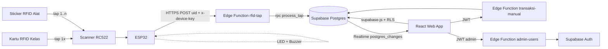

# Plan Implementasi v2: Sistem Peminjaman Alat Lab Berbasis RFID + Web (PKM)

> **Perubahan besar dari v1:** Firebase (Auth + Firestore + Cloud Functions + Hosting) → **Supabase** (Auth + Postgres + Edge Functions + Realtime). UI direvisi (20 poin revisi, dipetakan di Bagian 8). Alur tap disederhanakan: **tap kartu sekali, lalu tap sticker alat sebanyak yang dipinjam**, tanpa konfirmasi manual petugas.

## 0. Asumsi yang Dipakai (koreksi kalau salah)

| # | Asumsi | Alasan |
|---|---|---|
| 1 | Konfirmasi petugas **dihapus**. Tap langsung masuk sebagai transaksi, petugas melihatnya di **Realtime Card**. | Kamu minta "Persetujuan" → "Realtime Card" dan data "langsung masuk". |
| 2 | Jenis deteksi dihitung **per alat**: sticker alat yang sedang dipinjam kartu itu → *dikembalikan*; selain itu → *dipinjam*. Untuk tap kartu: belum punya pinjaman aktif → *dipinjam*, punya pinjaman aktif → *dikembalikan*. | Cocok dengan aturanmu (#11) dan tetap benar kalau satu kartu pinjam+kembalikan barang campur dalam satu sesi. |
| 3 | Sesi kartu berlaku **60 detik**, diperpanjang tiap tap alat. | Agar tap alat tidak perlu tap kartu ulang (#16), tapi kartu tidak "nyangkut" selamanya. |
| 4 | Satu baris `alat` = satu jenis alat dengan **satu sticker** dan `jumlah_total` unit. Tiap tap sticker = 1 unit. | Sesuai stok "4/5" (#13, #14). Kalau mau tiap unit punya sticker sendiri, bilang — schema perlu tabel `alat_unit`. |
| 5 | Unit **rusak tidak bisa dipinjam** (stok yang bisa dipinjam = tersedia − rusak). | Supaya alat rusak tidak keluar lagi. |
| 6 | Poin #19 tidak ada di daftarmu (loncat 18 → 20), dianggap tidak ada. | — |
| 7 | "di page minimal ada gambar" (#1) dibaca: logo SMK tampil di setiap halaman (header sidebar + favicon). | Kalau maksudmu banner/ilustrasi per halaman, tinggal tambah. |

---

## 1. Arsitektur



**Pembagian tugas backend**
- **Edge Function**: semua yang butuh rahasia / logika bisnis / bypass RLS → `rfid-tap`, `transaksi-manual`, `admin-users`.
- **Postgres function (RPC)**: logika atomik pinjam/kembali & stok (`process_tap`, `process_manual`) — dipanggil edge function, jadi tidak ada race condition antar tap.
- **supabase-js + RLS langsung**: baca data (tabel, dashboard) dan CRUD sederhana admin (alat, kartu). Aman karena dijaga Row Level Security.
- **Realtime**: `tap_log`, `transaksi`, `alat` → Realtime Card, badge notifikasi, chart dashboard.

## 2. Tech Stack

| Layer | Teknologi |
|---|---|
| Hardware | ESP32 + RC522 (1 atau 2 modul) + kartu Mifare 1K + sticker RFID + LED + buzzer |
| Firmware | Arduino IDE / PlatformIO |
| Frontend | React + Vite + Tailwind, **font Poppins**, Recharts (bar + area), TanStack Table (sort/search), `@supabase/supabase-js` |
| Auth | Supabase Auth (email/password, signup publik dimatikan) |
| Database | Supabase Postgres + RLS |
| Backend | Supabase Edge Functions (Deno, JavaScript) |
| Realtime | Supabase Realtime |
| Hosting web | Vercel / Netlify / Cloudflare Pages (Supabase tidak host frontend) |

## 3. Role & Akses

| Role | Akses |
|---|---|
| **Admin** | Semua: CRUD alat (Inventaris), kartu RFID, akun petugas, semua laporan |
| **Petugas** | Lihat Realtime Card, Riwayat, List Barang; peminjaman/pengembalian manual; edit kondisi alat (jumlah rusak) |
| **Perwakilan kelas** | Tidak login. Hanya tap kartu + sticker |

## 4. Alur Tap (Business Logic)

Firmware **tidak perlu tahu** mana kartu dan mana alat. ESP32 cukup kirim tiap UID; server menentukan.

```
Tap kartu  ─► validasi kartu aktif ─► buat/perbarui sesi (60 dtk)
              jenis_terdeteksi = belum ada pinjaman aktif ? "pinjam" : "kembali"
              ─► tap_log (muncul di Realtime Card + notifikasi)

Tap alat   ─► UID tidak dikenal?             -> ditolak  uid_tidak_dikenal
              tidak ada sesi kartu aktif?     -> ditolak  sesi_tidak_ada   (suruh tap kartu dulu)
              kartu ini sedang pinjam alat ini? -> KEMBALI (stok +1, transaksi ditutup)
              selain itu                         -> PINJAM  (stok -1, transaksi baru)
                                                    stok habis? -> ditolak stok_habis
              sesi diperpanjang 60 dtk ─► tap_log
```

Aturan:
- Debounce 3 detik untuk UID yang sama di device yang sama (tap ganda diabaikan).
- Kartu nonaktif ditolak (`kartu_nonaktif`).
- Alat yang sedang dipinjam kartu **lain** dan stok 0 → `stok_habis`.
- Semua ditulis atomik di Postgres → aman kalau 2 tap datang bersamaan.

**Kode respons API (kontrak untuk sisi IoT):**

| `error` | Arti |
|---|---|
| — (`ok:true`, `type:"kartu"`) | Kartu diterima, sesi mulai |
| — (`ok:true`, `type:"alat"`) | Pinjam/kembali berhasil |
| `kartu_nonaktif` | Kartu diblokir |
| `uid_tidak_dikenal` | UID belum terdaftar |
| `sesi_tidak_ada` | Belum tap kartu / sesi habis |
| `stok_habis` | Tidak ada unit tersedia |
| gagal koneksi / 5xx | Jaringan/server bermasalah |

> Cara IoT menampilkan tiap kode (LED, buzzer, dll) ditentukan di project IoT sendiri.

## 5. Database Schema (Supabase Postgres)

File lengkap: `supabase/migrations/20260920000000_init.sql`

| Tabel | Isi | Pengganti di Firebase |
|---|---|---|
| `profiles` | id (= `auth.users.id`), nama, email, `role` (admin/petugas), aktif | `users` |
| `kartu_rfid` | `uid_kartu` (PK), kelas, nama_pemegang, aktif | `kartu_rfid` |
| `alat` | kode, nama, kategori, `uid_rfid` (unik), `jumlah_total`, `jumlah_rusak`, `stok_tersedia` | `alat` |
| `transaksi` | 1 baris = 1 unit: kartu, kelas, alat, **`status`** (dipinjam/dikembalikan), **`sumber`** (otomatis/manual → kolom *Terkirim*), `kondisi_pinjam`, `kondisi_kembali`, waktu_pinjam, waktu_kembali, petugas_id, catatan | `transaksi` |
| `tap_log` | Log tiap tap: jenis_tap, kelas, alat, **`jenis_terdeteksi`**, kondisi, status berhasil/ditolak, error_code, `is_read`, `waktu_tap` (tanggal+jam) | `tap_log` |
| `kartu_session` | Sesi kartu per device (expires_at) | *baru* |
| `devices` | Daftar ESP32 + hash API key | *baru* |
| `error_log` | Error server di produksi | *baru* |

**View:** `v_list_barang` (stok "4/5", status, kondisi, kartu peminjam), `v_stat_harian` (30 hari untuk bar + area chart).

**Function penting:** `process_tap`, `process_manual` (hanya service_role), `update_kondisi_alat`, `set_kondisi_kembali`, `mark_taps_read` (authenticated, dicek role di dalam).

**Catatan model stok:**
`jumlah_total` = total unit · `stok_tersedia` = total − sedang dipinjam · `jumlah_rusak` = unit rusak. Contoh: total 5, dipinjam 1, rusak 1 → tersedia 4, bisa dipinjam 3, tampil "4/5", kondisi "rusak (1)".

## 6. Auth & Keamanan

1. **Signup publik dimatikan** (`enable_signup = false`). Akun hanya dibuat admin lewat edge function `admin-users`.
2. Login: `supabase.auth.signInWithPassword`. Role dibaca dari `profiles` (bukan dari `user_metadata`, karena bisa diubah user).
3. **RLS aktif di semua tabel.** Staff (admin/petugas) boleh `select`; tulis `alat`/`kartu_rfid` hanya admin; **tulis `transaksi`/`tap_log` hanya service_role** (edge function).
4. ESP32 autentikasi dengan `x-device-id` + `x-device-key` (hash SHA-256 disimpan di `devices`). Key asli hanya ada di firmware. Jika ESP32 hilang → set `devices.aktif = false`.
5. `SUPABASE_SERVICE_ROLE_KEY` **tidak pernah** masuk frontend/firmware/git. Frontend hanya pakai `anon` key.
6. Admin pertama: buat user di Dashboard → jalankan SQL `update public.profiles set role='admin' ...` (ada di akhir file migrasi).

**Edge Functions**

| Function | Siapa | Auth | Fungsi |
|---|---|---|---|
| `rfid-tap` | ESP32 | `x-device-key` (`--no-verify-jwt`) | Proses tiap tap |
| `transaksi-manual` | Admin/Petugas | JWT user | Peminjaman & pengembalian manual (jumlah, kondisi, catatan) |
| `admin-users` | Admin | JWT + cek role admin | Buat/ubah/hapus akun petugas |

## 7. Struktur Halaman & Sidebar

```
Sidebar (logo SMK + nama sekolah di atas)
├─ Dashboard
├─ Realtime Card          ← (dulu "Persetujuan") + badge notifikasi
├─ Peminjaman Manual
├─ Pengembalian Manual
├─ Riwayat Peminjaman
├─ List Barang
├─ Inventaris Barang      (admin)
├─ Kartu RFID             (admin)
├─ Pengguna               (admin)
├─ ─────────── <hr> ───────────
└─ Keluar                 (tombol merah, di paling bawah sidebar)
```

**Login:** logo SMK + nama sekolah, form email/password, gambar sekolah (split layout di desktop; gambar jadi header di mobile).

**Dashboard:** greeting "Selamat datang, {nama}" → card ringkasan → **Bar chart (dipinjam vs dikembalikan per hari) + Area chart (tren transaksi)** → tabel riwayat terbaru.

**Realtime Card** (halaman utama IoT):
- Kolom: **Waktu Tap (tanggal + jam)**, Kelas, Kartu ID, Jenis Tap (kartu/alat), Alat, **Jenis Deteksi** (badge Dipinjam/Dikembalikan, *read-only*), Kondisi, Hasil (berhasil/ditolak + alasan).
- Baris baru masuk lewat Supabase Realtime, animasi highlight 3 detik.
- Tidak ada dropdown jenis — otomatis dari server.
- Layout kartu per tap (bukan cuma tabel) supaya nanti gampang disesuaikan dengan tampilan IoT.

**Notifikasi tap:** badge angka merah di menu Realtime Card + ikon bel di pojok kanan atas (jumlah `tap_log.is_read = false`) + toast saat tap masuk. Buka Realtime Card → panggil `mark_taps_read()`.

**Peminjaman/Pengembalian Manual (lengkap):** pilih kartu/kelas (searchable), pilih alat (tampilkan stok sisa & kondisi), jumlah (stepper), kondisi barang (baik/rusak — untuk pengembalian), catatan, ringkasan sebelum submit, dan panel "pinjaman aktif kartu ini" (pada pengembalian). Submit → edge function `transaksi-manual`.

**Riwayat Peminjaman:** kolom Waktu Pinjam, Waktu Kembali, Kelas, Kartu ID, Alat, **Status** (dipinjam/dikembalikan), **Kondisi Barang**, **Terkirim** (otomatis/manual), Petugas. Kondisi bisa dikoreksi lewat `set_kondisi_kembali`.

**Inventaris Barang** (fokus tambah alat baru): form tambah alat (kode, nama, kategori, UID sticker — bisa "scan" dari Realtime Card, total unit). Tanpa kolom status, tanpa stok "4/5".

**List Barang:** Nama, Kode, **Stok "4/5"**, **Status** (tersedia/dipinjam), **Kondisi** (baik/rusak + edit jumlah rusak inline), **Kartu ID peminjam** (dari `v_list_barang.peminjam`).

**Semua tabel** memakai satu komponen `DataTable`: sort ascending/descending di header, search box, pagination, empty state, loading skeleton.

## 8. Checklist 20 Revisi → Implementasi

| # | Revisi | Implementasi |
|---|---|---|
| 1 | Logo SMK + gambar di page | `src/assets/logo-smk.png` di header sidebar, favicon, tiap halaman |
| 2a | Login: gambar + nama sekolah | Layout login split, konfigurasi `VITE_SCHOOL_NAME` |
| 2b | Greeting di atas card | `Selamat datang, {profiles.nama}` di Dashboard |
| 3 | Ganti backend/DB/auth ke Supabase + Edge Function | Bagian 5, 6 + folder `supabase/` |
| 4 | Kondisi barang di Riwayat | `transaksi.kondisi_pinjam / kondisi_kembali` + kolom di tabel |
| 5 | Bar + area chart di dashboard | Recharts + `v_stat_harian`, di antara card dan tabel riwayat |
| 6 | Garis pemisah di sidebar | `<hr>` sebelum tombol Keluar (dan pemisah antar grup menu) |
| 7 | Tabel: sort asc/desc + search | Komponen `DataTable` (TanStack Table) dipakai semua tabel |
| 8 | "Persetujuan" → "Realtime Card" | Halaman baru, subscribe `tap_log` |
| 9 | Form manual lebih lengkap | Bagian 7, Peminjaman/Pengembalian Manual |
| 10 | Notifikasi setelah tap kartu | Badge sidebar + bel kanan atas + toast (`tap_log.is_read`) |
| 11 | Deteksi otomatis, tidak bisa dipilih; waktu tap tgl+jam | `jenis_terdeteksi` dari server, badge read-only, `waktu_tap` `dd MMM yyyy HH:mm:ss` (Asia/Jakarta) |
| 12 | Riwayat: "Jenis" → "Status"; "Persetujuan" → "Terkirim" (otomatis/manual) | `transaksi.status`, `transaksi.sumber` |
| 13 | Inventaris = tambah alat baru; hapus status & stok 4/5 | Halaman Inventaris hanya CRUD alat + jumlah total |
| 14 | List Barang: stok sisa, status, kondisi, kartu peminjam | `v_list_barang` |
| 15 | Error handling prod & local | Bagian 9 |
| 16 | Tap kartu 1x, lalu tap sticker alat saja | `kartu_session` (60 dtk, auto-perpanjang) |
| 17 | Tombol Keluar di sidebar, merah | Paling bawah sidebar, `bg-red-600` |
| 18 | Dashboard responsive | Sidebar → drawer di mobile, grid `1/2/4` kolom, tabel scroll horizontal |
| 20 | Font Poppins | `@fontsource/poppins` + `fontFamily.sans` di Tailwind |

## 9. Error Handling (Production vs Local)

**Edge Function** (`_shared/http.js`, sudah diimplementasi):
- Format error seragam: `{ ok:false, error:"kode", message:"...", request_id }`.
- `APP_ENV=local` → response menyertakan `details` + `stack`. `APP_ENV=production` → hanya pesan generik; detail masuk `console.error` (Supabase Logs) + tabel `error_log`, dicari lewat `request_id`.
- Error bisnis (4xx) tidak masuk `error_log`, hanya 5xx.

**Frontend:**
```js
// src/lib/handleError.js
const isProd = import.meta.env.PROD;
export function handleError(e, fallback = "Terjadi kesalahan, coba lagi") {
  const err = e ?? {};
  if (!isProd) console.error("[DEV]", e);                 // lokal: detail lengkap di console
  const msg = err?.message ?? fallback;
  toast.error(isProd && err?.request_id ? `${msg} (ref: ${err.request_id.slice(0, 8)})` : msg);
  // produksi: opsional kirim ke Sentry di sini
}
```
- React `ErrorBoundary` di root: produksi → halaman "Terjadi kesalahan" + tombol muat ulang; lokal → tampilkan stack.
- Realtime disconnect → banner "Koneksi terputus, mencoba menyambung ulang…" (channel `.subscribe(status => …)`).
- Semua query: state `loading / error / empty` eksplisit.

**IoT:** error handling perangkat (retry, buffer offline, indikator, mode debug) dikerjakan di project IoT sendiri. Sisi web/backend hanya menyediakan kode error yang konsisten (Bagian 4 dan 11).

## 10. Kode Kunci Frontend

```js
// src/lib/supabase.js
import { createClient } from "@supabase/supabase-js";
export const supabase = createClient(
  import.meta.env.VITE_SUPABASE_URL,
  import.meta.env.VITE_SUPABASE_ANON_KEY,   // anon key saja, BUKAN service_role
);
```

```js
// src/lib/api.js — panggil edge function dengan JWT user
import { supabase } from "./supabase";
export async function callFunction(name, body) {
  const { data, error } = await supabase.functions.invoke(name, { body });
  if (error) {
    // FunctionsHttpError: ambil body JSON error kita
    const payload = await error.context?.json?.().catch(() => null);
    throw payload ?? error;
  }
  return data;
}
// contoh: await callFunction("transaksi-manual", { uid_kartu, alat_id, jenis: "pinjam", jumlah: 2 });
```

```js
// src/hooks/useAuth.jsx — session + role dari profiles
// onAuthStateChange -> ambil profiles(nama, role, aktif) -> expose { user, profile, isAdmin, signOut }
// <RequireRole roles={["admin"]}> untuk route /inventaris, /kartu, /pengguna
```

```js
// src/hooks/useRealtimeTaps.js — Realtime Card + badge + toast
export function useRealtimeTaps() {
  const [taps, setTaps] = useState([]);
  const [unread, setUnread] = useState(0);

  useEffect(() => {
    supabase.from("tap_log").select("*").order("waktu_tap", { ascending: false }).limit(50)
      .then(({ data }) => setTaps(data ?? []));
    supabase.from("tap_log").select("id", { count: "exact", head: true }).eq("is_read", false)
      .then(({ count }) => setUnread(count ?? 0));

    const ch = supabase.channel("tap-log")
      .on("postgres_changes", { event: "INSERT", schema: "public", table: "tap_log" }, (p) => {
        setTaps((t) => [p.new, ...t].slice(0, 50));
        setUnread((n) => n + 1);
        toast(`Kelas ${p.new.kelas ?? "?"} tap kartu/alat`);
      })
      .subscribe();
    return () => { supabase.removeChannel(ch); };
  }, []);

  const markRead = async () => { await supabase.rpc("mark_taps_read"); setUnread(0); };
  return { taps, unread, markRead };
}
```

```js
// tailwind.config.js
theme: { extend: { fontFamily: { sans: ["Poppins", "ui-sans-serif", "system-ui", "sans-serif"] } } }
// main.jsx: import "@fontsource/poppins/400.css"; "500.css"; "600.css"; "700.css"
```

Query List Barang: `supabase.from("v_list_barang").select("*")`. Tampil stok: `` `${stok_tersedia}/${jumlah_total}` ``. Edit jumlah rusak: `supabase.rpc("update_kondisi_alat", { p_alat_id, p_jumlah_rusak })`.

## 11. IoT (Plan Saja)

Logic IoT (firmware, wiring, retry, LED/buzzer) **tidak diimplementasi di dokumen ini** — dikerjakan di project IoT sendiri. Yang perlu diketahui sisi IoT:

- **Tugas perangkat:** baca UID tiap tap (kartu maupun sticker alat, 1 atau 2 scanner sama saja) lalu kirim ke endpoint. Tidak perlu membedakan kartu/alat, tidak perlu menyimpan sesi — server yang mengurus.
- **Endpoint:** `POST https://<project-ref>.supabase.co/functions/v1/rfid-tap`
- **Header:** `Content-Type: application/json`, `apikey: <anon key>` (untuk gateway Supabase), `x-device-id`, `x-device-key`
- **Body:** `{ "uid": "A1B2C3D4" }` (hex uppercase)
- **Respons:** `ok`, `type` (`kartu`/`alat`), `jenis`, `error` — daftar kode di Bagian 4.
- **Keamanan:** `x-device-key` hanya ada di perangkat (jangan di-commit). Perangkat hilang → set `devices.aktif = false`.

## 12. Langkah Setup & Fase

**Setup Supabase (sekali):**
```bash
npm i -g supabase            # atau: npx supabase ...
supabase init
supabase login && supabase link --project-ref <PROJECT_REF>
# salin isi config.toml.snippet ke supabase/config.toml
supabase db push             # jalankan migration
supabase secrets set APP_ENV=production ALLOWED_ORIGIN=https://domain-web-kamu.com
supabase functions deploy rfid-tap --no-verify-jwt
supabase functions deploy transaksi-manual
supabase functions deploy admin-users
```
Lokal: `supabase start` → `supabase functions serve --env-file supabase/functions/.env`.
Lalu: buat admin pertama + daftarkan device (SQL di akhir file migrasi).

| Fase | Task |
|---|---|
| 1 | Supabase project, migration, admin pertama, disable signup |
| 2 | Hardware: wiring, baca UID via Serial |
| 3 | Edge function `rfid-tap` + test `curl` → ESP32 |
| 4 | Frontend: auth, layout sidebar, Poppins, login, dashboard + chart |
| 5 | Realtime Card + notifikasi + DataTable (sort/search) |
| 6 | Inventaris, List Barang, Kartu, Pengguna |
| 7 | Peminjaman/Pengembalian Manual + Riwayat |
| 8 | Error handling, responsive, test end-to-end, polish PKM |

**Test cepat edge function (tanpa hardware):**
```bash
curl -X POST "$SUPABASE_URL/functions/v1/rfid-tap" \
  -H "apikey: $ANON_KEY" -H "x-device-id: lab-esp32-01" -H "x-device-key: $KEY" \
  -H "Content-Type: application/json" -d '{"uid":"A1B2C3D4"}'
```

## 13. Yang Perlu Disiapkan

1. Project Supabase (catat Project URL + anon key + project ref).
2. Logo SMK (PNG transparan) + foto/gambar sekolah + nama sekolah resmi.
3. Daftar kelas + UID kartu, daftar alat (nama, kode, kategori, jumlah, UID sticker) — bisa di-import CSV lewat Table Editor Supabase.
4. Email admin & petugas awal.
5. Putuskan: 1 sticker per jenis alat (sesuai asumsi #4) atau 1 sticker per unit.